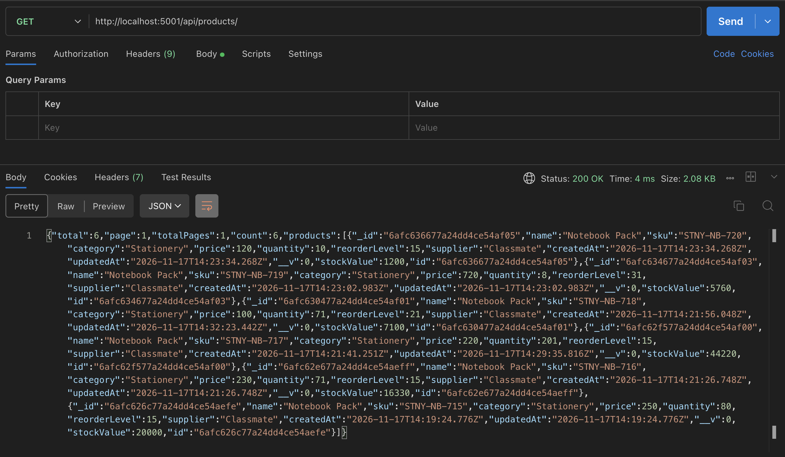
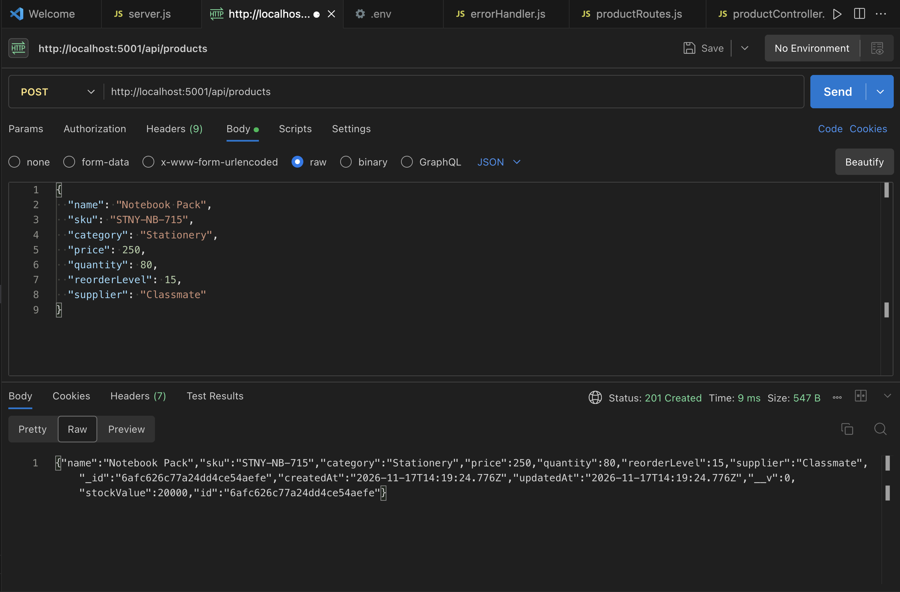
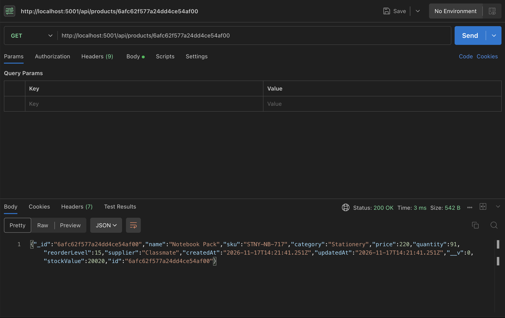
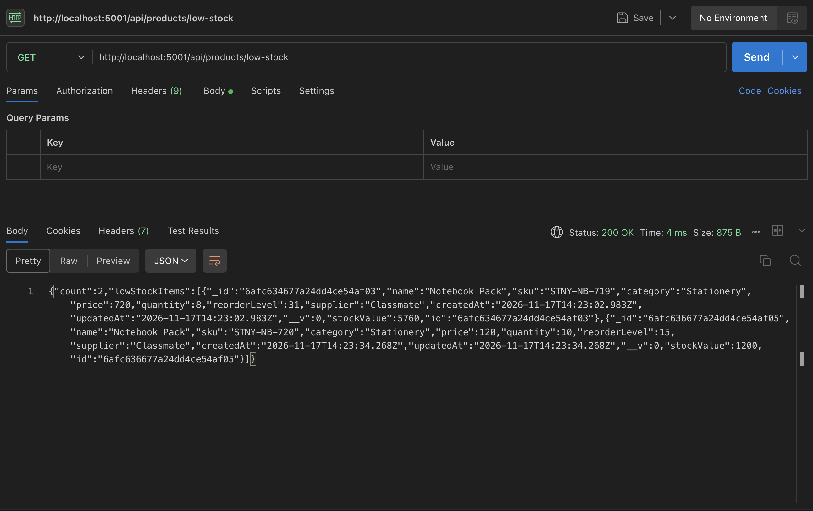
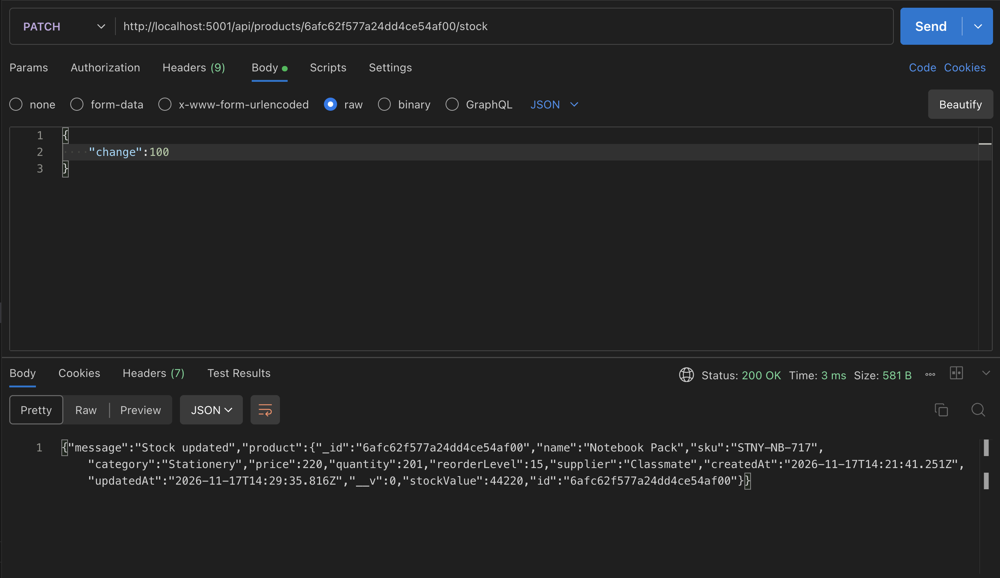
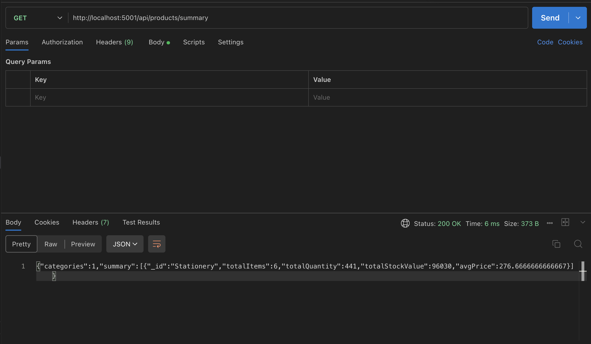
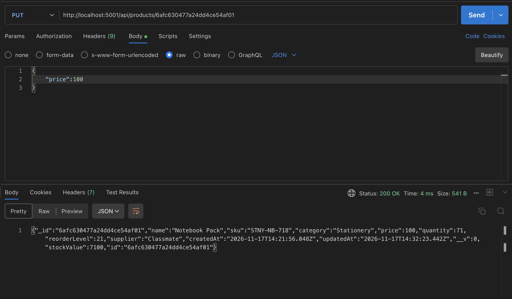

# WEB-DEVELOPMENT-ASSIGNMENT-3
## Project Screenshots

### 1. Get All Products

### 2. Create Product

### 3. Get Single Product

### 4. Low Stock Products

### 5. Stock Patch

### 6. Product Summary

### 7. Update Product

